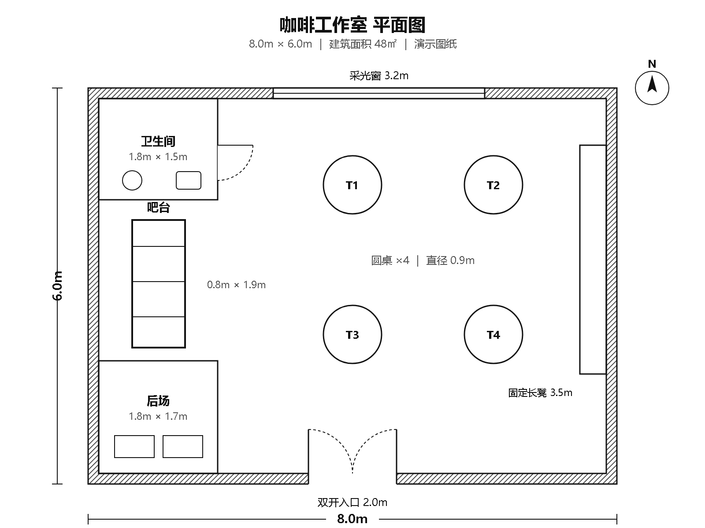
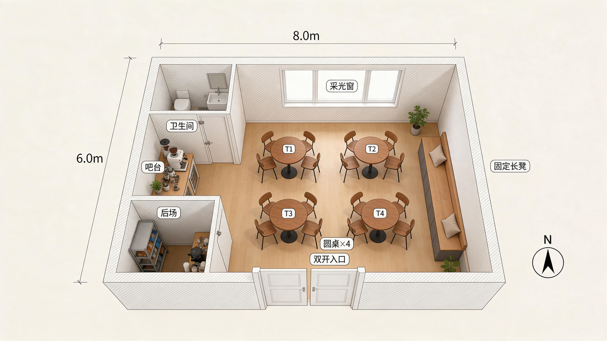

# LeanEdge 工厂布局与空间表达

把场地尺寸、固定设施和业务动线说清楚，再选择合适的布局或空间表达方式。本仓库提供可核验的演示材料；商品功能、价格和权益以对应平台详情页当前展示为准。

## 第一次来，先看你能拿到什么

LeanEdge把AI接进具体工作：先给真实输入和可核对结果，再谈工具。品牌本色是简单、有趣、有价值；这里的演示不是客户业绩，也不是收益承诺。

| 你眼下的任务 | 先看的作品 | 可以核对的成果 |
|---|---|---|
| 仓库退货与待发货混放，接班人判断不清 | [180㎡退货隔离案例](./examples/warehouse-180-return-isolation/README.md) | 固定分区输入、原始输出、三张可填写核对表、完整配音视频 |
| 换型停机复盘，不知道哪段值得改善 | [SMED换型报告](./examples/smed-changeover-report/README.md) | 动作计时、两张报告图、教学输入和离线报告 |
| 三张订单同时催，先做哪张更合适 | [三单排产对比](./examples/production-priority-three-orders/README.md) | EDD/SPT对照、甘特图、复算代码和完整讲解 |

**下一步只选一件事：**有图纸想先看概念表达，按下方资料清单[申请一次效果预览](https://www.goofish.com/item?id=1080049343062)；想自己使用工具，进入与任务匹配的商品页。不要把图纸、客户资料或订单信息贴在公开评论里。

关注方向：**LeanEdge**讲AI应用与管理实践，**LEANE-AI**讲自有技能的具体输入、结果与边界；两者分工不同，不用同一篇稿到处重复投放。

## 先选你要解决的问题

### 需要梳理工厂或仓库的区域与动线

打开 [工厂智能布局设计助手](https://www.coze.cn/skills?skill_share_pid=7597450318019903551)，准备场地长宽、用途、出入口、固定设施、设备清单和主要作业顺序。输出用于前期方案沟通，现场尺寸、通道、安全、消防及工程要求需由专业人员复核，不是施工图。

[查看官网布局演示与咨询入口](https://www.angetlean.com/layout/) · [闲鱼服务详情](https://www.goofish.com/item?id=1080049343062)

### 已有平面图，想先看空间概念表达

扣子中有两款独立商品，不是同一个版本：

- [2D平面图转3D效果图专业版（PID 7688406481955241984）](https://www.coze.cn/skills?skill_share_pid=7688406481955241984)——独立商品，功能、现价和订阅权益以该商品页当前展示为准。
- [2D平面转3D效果图（PID 7640904637083664434）](https://www.coze.cn/skills?skill_share_pid=7640904637083664434)——独立商品，不与上方专业版合并承诺，功能、现价和权益以当前商品页为准。

请分别查看各自的商品说明、案例与当前价格；价格不同不代表质量或输出一致。下方48㎡材料是一次历史概念演示，不证明任一现售版本对所有图纸都能稳定还原。

[查看48㎡演示的输入、输出与短片](./examples/2d-to-3d-48sqm/README.md)

## 180平方米仓库退货隔离

退货箱与待发货怎样在位置和状态上分开？案例包含固定分区业务输入、技能原始PNG/SVG、约198秒事件先行完整配音讲解，以及需求采集、设备登记、验收检查三张可填写表。

[查看180㎡仓库案例与完整视频](./examples/warehouse-180-return-isolation/README.md)。这是自有虚拟场景，预设分区转图，不是客户现场或自主优化结果。

## 48平方米历史概念演示

这份历史输出已发现设备数量与位置对应问题，不能作为精确还原或当前产品稳定能力的证明。材料保留供对照；新访客建议先看上方已列明输入、成果与边界的作品。

展开历史48㎡输入、概念输出与短片

下图来自 LeanEdge 自有的 48㎡咖啡工作室演示图纸与一张历史技能概念输出，不是客户案例或工程成果。图纸 8m × 6m，包含吧台、座位、入口、窗与后场等空间要素。

### 平面输入

### 一次三维概念输出

[观看对应演示短片（MP4）](./examples/2d-to-3d-48sqm/factory-skill-story-v5.mp4)

这是单次历史演示，不能据此推断对任意图纸都能稳定还原。完整输入、核对点和限制见[案例说明](./examples/2d-to-3d-48sqm/README.md)。

## 想用自己的图纸申请预览

1. 准备你有权使用的平面图，以及场地长宽、入口和窗的位置。
2. 标出不可移动设施、用途和最希望表达的问题；客户信息、地址等敏感内容请先脱敏。
3. [申请一次免费效果预览](https://www.goofish.com/item?id=1080049343062)，或添加微信 **lifewithlove88** 咨询。预览只用于前期讨论，不含完整布局服务；是否承接、价格和交付范围以平台商品详情及双方确认内容为准。

不方便公开图纸？请勿在公开 Issue、评论或截图中上传客户图纸、尺寸、订单、密钥、Token 或账号信息。

## 生产运营工具

- 换型复盘：[查看SMED报告的两张实际图、可复制输入及离线报告](./examples/smed-changeover-report/README.md)，或直接查看[Capafy下载商品](https://capafy.ai/zh/agent/smed-visual-changeover-report-kit/9311408133)。演示中区分动作时长、停机历时与未验证改善方案。
- 已有订单需要排生产顺序：[看三张订单的EDD/SPT实际对比、甘特图与复算代码](./examples/production-priority-three-orders/README.md)，或查看 [Production Scheduling Pro](https://capafy.ai/zh/agent/production-scheduling-pro/2804152601)。这是独立下载商品，不与SMED报告或上方Coze商品自动串联；购买内容和运行要求见对应商品页。

## AI工作流实操配套

- [咨询表单先分3条路：n8n代码、输入输出与9个本地检查](./examples/n8n-consultation-routing/README.md)。纯JavaScript教学逻辑，不发送消息；明确当前批次与跨次执行的去重边界，未部署为生产工作流。

- [本地AI慢先别换显卡：Ollama计时检查、教学输入与18项本地测试](./examples/ollama-timing-check/README.md)。只读取已有响应，不调用模型、不测硬件；区分等待阶段与根因，教学数值不当跑分。

- [AI客服单库密钥检查：原代码、10项离线测试与凭据登记表](./examples/dify-scope-check/README.md)。先在假数据上练习，再由获授权的维护者核验真实实例；不把GET检查当作密钥只读权限认证。

## AI深度阅读

- [AI开始跨越学科：一个物理学家的经历，让我重新想了5种专业能力的价值](./articles/ai-cross-disciplinary-judgment/README.md)。近万字原创分析，配4张图、可下载教学数据与原绘图脚本；区分参与者自述、研究证据、本文判断和教学假设，不冒充科学成果复现。

## 仓库里的其他项目

仓库还保留 OpenClaw 技能包（见 `office/`）以及 Codex Skills（`negative-asset-global-allocation/`、`reference-image-to-threejs-asset/`）。它们是独立项目，不属于上面两款 Coze 商品的交付范围，也不共用价格或服务承诺。

## 联系与反馈

- 仓库所有者：[@S370035760](https://github.com/S370035760)
- 微信：`lifewithlove88`
- 邮箱：[fief6464@gmail.com](mailto:fief6464@gmail.com)
- 当前仓库：[S370035760/practical-skills](https://github.com/S370035760/practical-skills)

## 公开资料

- [工厂智能布局设计助手（PID 7597450318019903551）](https://www.coze.cn/skills?skill_share_pid=7597450318019903551)
- [2D平面图转3D效果图专业版（PID 7688406481955241984）](https://www.coze.cn/skills?skill_share_pid=7688406481955241984)
- [2D平面转3D效果图（PID 7640904637083664434）](https://www.coze.cn/skills?skill_share_pid=7640904637083664434)
- [48㎡历史演示说明](./examples/2d-to-3d-48sqm/README.md)
- [官网布局与服务入口](https://www.angetlean.com/layout/)

内容说明：本页含人工智能生成合成内容。产品与服务范围以实际商品页和双方确认内容为准。
