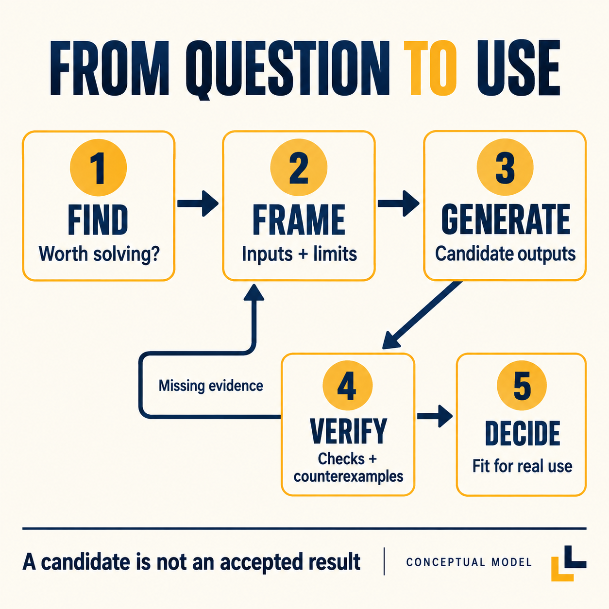
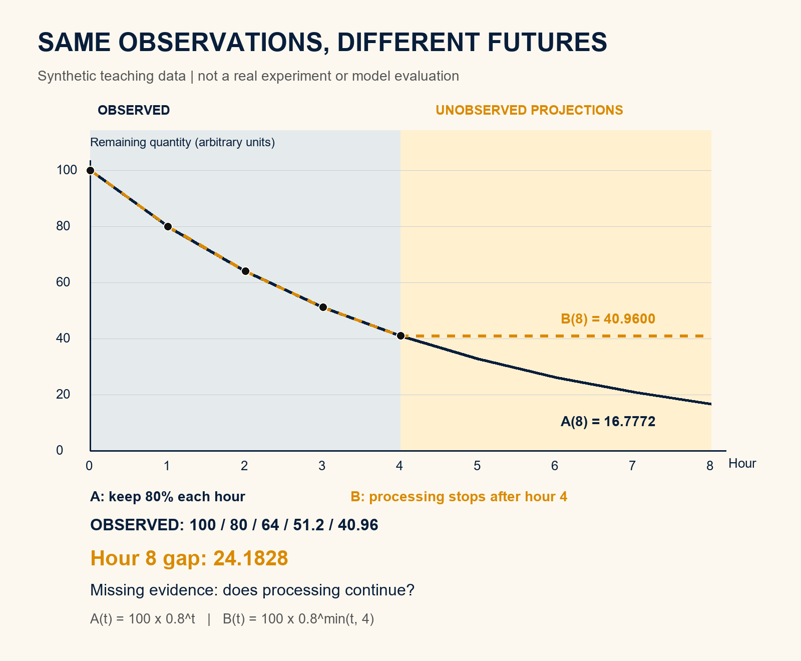
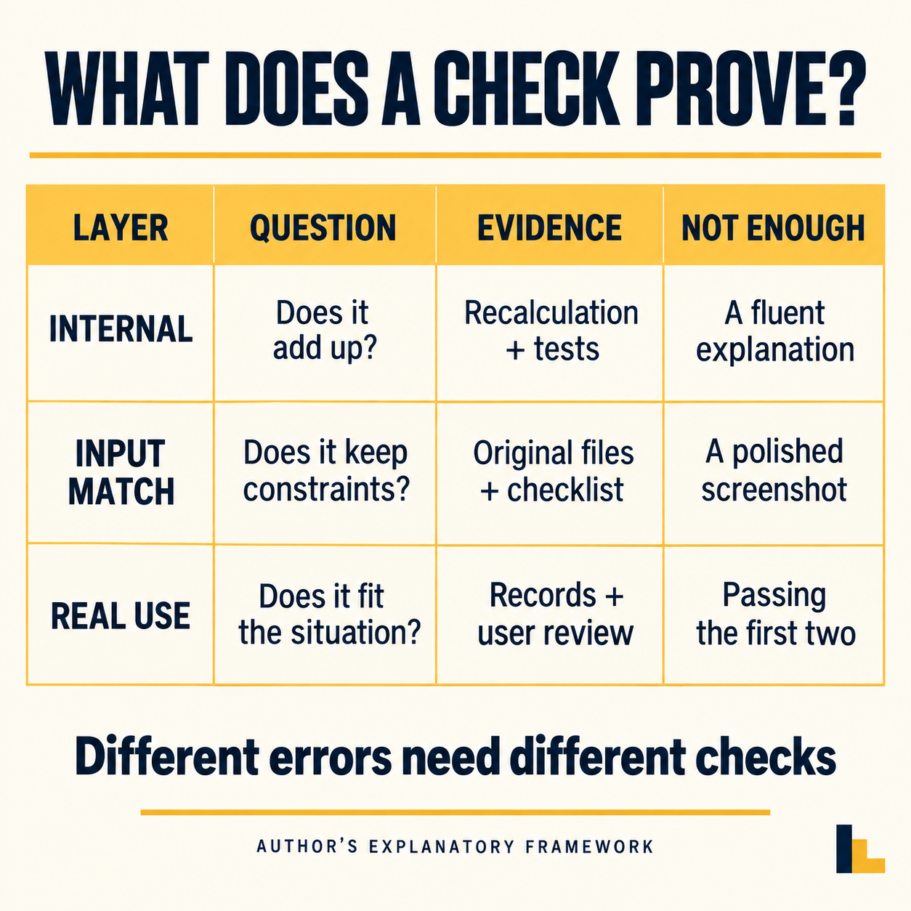

# AI开始跨越学科：一个物理学家的经历，让我重新想了5种专业能力的价值

LeanEdge · 2026-10-16

一个物理学家，用AI把方法带进了自己的专业之外。结果算出来了，另一门学科的专家却未必觉得重要。

这比“AI又解出一道难题”更值得追下去：如果一个人借助AI，已经能够越过原来进不去的技术门槛，专业能力究竟会变便宜，还是变得更值钱？

2026年10月1日，Matthew Schwartz在Anthropic网站发表《Claude-shaped science》。他的自述提到，自己借助Claude开发BootLoops计算工具，把方法带向生态学等领域。

部分起初技术上成立的结果，要经领域专家引导，才转向更有研究意义的问题。[1]

需要把来源摆清楚：这是参与者的自述，刊在模型厂商的网站上；作者在项目期间担任Anthropic访问研究者，BootLoops由其本人维护。本文没有运行这个项目，也不独立确认其中的科学成果。

但这个细节提出了一个具体问题：当“把东西做出来”的难度下降，“知道该做什么、做到什么才算数”的价值，会发生怎样的变化？

我不想用一句“人类负责创意，AI负责执行”把它糊过去。真实任务没有分得这么干净：执行可能逼出新的想法，错误可能藏在题目里，所谓创意也可能只是漂亮的空话。

我的判断是：AI带来的变化，值得沿着五种能力重新看——找到值得解决的问题，把问题翻译成可操作的表达，生成候选结果，验证结果，以及决定结果能否进入现实。它们原来常被包在同一个岗位里，现在开始可以重新组合。

五类能力重新组合，箭头不代表前一步自动担保后一步。

## 一、原来挡住我们的，有时不是问题，而是中间那几道门

设想一个明确标为假设的场景：一位制造企业的培训负责人，想知道新员工在哪一段操作最容易返工。他手里有检查记录、培训签到表和几份班组交接单，却没有分析程序。

以前，他可能先找信息部门导数据，再找会统计的人整理，最后请现场主管解释。每个环节都有道理，也每个环节都可能让问题暂时停下来。

这不等于企业里的人不负责。不同表格的时间口径可能不一致，同一个员工在不同系统里可能有不同编号，返工记录里也未必写了具体工序。把这些拼起来，本来就需要劳动。

如果AI能帮助读文件、写转换程序、指出缺失字段、生成一张可以讨论的图，培训负责人获得的就不只是一段答案，而是第一次把问题摆到桌面上的能力。

过去他可能说：“我觉得培训没有讲透。”现在他至少可以问：“这张图里，哪些返工发生在首次独立操作之前，哪些发生在之后？我们是不是把两类问题混在了一起？”

注意这个变化的边界。图画出来，并不能证明培训导致了返工；返工集中在新人身上，也可能因为新人被安排在更难的岗位。AI让问题变得可见，不等于替我们排除了所有解释。

但能问出第二个问题，已经与停留在模糊感受里不同。这是我理解AI应用价值的一个起点：它缩短了从“心里觉得不对”到“拿着具体对象讨论”的距离。

跨学科也有相似的中间门槛。某个领域的问题，可能已经在另一个领域拥有成熟的表达方式。难处在于，提问的人不知道方法的名字，会方法的人又不知道这里存在这个问题。

假设一个人只把积压看成“大家忙不过来”，另一个人习惯讨论到达率、处理能力和等待时间，他们甚至可能在描述同一件事，却没有共同的语言。

AI有机会充当这个翻译过程的一部分：把叙述拆成变量、条件和约束，提出可能相关的方法，再把方法的要求翻译回来，告诉提问者还缺什么。

我说的是“有机会”，不是它一定翻得对。一个漂亮的数学表达，也可能删掉现实里最关键的条件。例如把所有任务当成可以随时中断的小件，就可能漏掉真实生产中的清洗、换型和等待。

因此，专业门槛不是一堵同时倒下的墙。有些是记忆和操作的门槛，有些是资料和许可的门槛，还有些来自判断：你知道这个表达在哪种条件下根本不能用。

AI可能帮助我们跨过前一种门，却不会自动给出后一种判断。危险也正在这里：门打开后，人容易把“终于进得去”误认成“已经懂得里面所有规则”。

我更愿意把这种变化理解成交通改善，而不是地形消失。你能够更快去到另一个专业的门口，仍然需要知道脚下是公路、桥梁，还是尚未勘测的地面。

这对普通工作者并不遥远。写程序、做图、整理资料原来是别人的专业入口，如今可能变成你自己能发起的试探；但你要多承担一件事：识别试探与结论之间的距离。

## 二、做得出来，为什么还可能不值得做

从那个物理学家的经历里，我想抽出的不是“AI让人全能”，而是一个顺序问题：我们究竟先寻找值得做的任务，还是先寻找自己能够展示的能力？

两条路都能开工，也都可能产生结果，但最后回答的不是同一个问题。

如果从能力出发，你会不断找到适合它的东西。能批量摘要，就寻找长文；能生成页面，就寻找展示场景；能写分析程序，就寻找能整理成表的数据。

这样做可以帮助探索，不应该一概否定。许多工具的价值，确实要用过以后才知道。问题在于，探索成功以后，不能省略下一问：这个结果改变了谁的哪个决定？

仍用前面的假设培训场景。AI生成了一份二十页分析报告，图表完整、术语严谨。但培训负责人明天仍不知道该改哪一段课程，主管也不知道该安排谁复训。

报告可能没有算错，却没有碰到需要解决的决定。它优化的是“把现有记录解释得完整”，而现场需要的是“在有限时间里找出一个可以验证的改动”。

于是，问题必须重新写：不是“分析所有培训数据”，而是“找出能支持一次具体培训改动的证据，同时列出不能由这些记录判断的部分”。

这不是把大问题缩小得没有志气，而是改变了成功的定义。原来成功是生成一份文档，现在成功是让某项行动拥有可解释的依据，并且知道什么证据会推翻它。

专业判断往往藏在这种改写里。熟悉现场的人知道，某项指标漂亮却没人能改变；某个数据难看，可能只是登记方式变了；某个问题很有意思，却不是此刻最值得投入的事情。

如果只看最终文件，这些贡献容易被忽略。它们不像代码行数和图片数量那样显眼，却决定后面的计算是在逼近问题，还是离问题越来越远。

我不赞成因此给“提问题”镀金。随口问一个宏大的问题很容易，要求别人把所有困难解决以后，再说自己负责方向，也不是专业价值。

一个有质量的问题，至少要给后续工作增加约束：对象是谁，结果用来干什么，哪些条件不能改，现有解释哪里不够，怎样才能判断前进了一步。

这些约束越具体，越容易发现问题是否真值得做。如果所有可能的结果都不会改变你的行动，那么这次分析可能只是好奇心练习，不能自动记成经营改善或科学进展。

好奇心练习也有价值，只是要按它的性质评价。探索的价值在于发现新的可能；交付的价值在于让别人能够使用；研究的价值还需要进入相应领域的证据和讨论。

把它们混在一起，就会出现一种常见错觉：因为演示令人兴奋，所以产品已经可靠；因为产品能运行，所以客户一定愿意买；因为客户愿意试，所以使用效果已经得到证明。

每一步都可能成立，却没有哪一步能靠前一步自动担保。AI把生成变快以后，这些被省略的过渡，反而更需要有人指出来。

这也是为什么我认为，专业能力并非简单地被压成一张价格更低的清单。某些操作确实可能更容易获得，但判断投入方向、定义有效证据的工作，不会因为按钮变少而消失。

## 三、五个数字，足以让一条漂亮曲线露出问题

为了把“算对不等于用对”说具体，我做了一个很小的算例。它完全是本文构造的教学数据，不来自客户，不是某个AI模型的能力测试，也不是科学实验。

一张表记录某个量在第零至第四小时的数值：100、80、64、51.2、40.96。每一步都是上一步的八成。只看这五个点，延长曲线似乎非常自然。

假设A规定，这个量在所有后续时段都会继续保留八成。按这个规则，第八小时是16.7772，数值保留四位小数。

假设B规定，前四小时之所以下降，是一项按小时减少剩余量两成的人工处理；第四小时后处理停止，也没有新流入或其他变化。因此，第八小时仍是40.96。

两种假设，在现有五个观察点上完全相同；到第八小时，数值相差24.1828。我已用本机计算核对这组数值。它说明的只是：这段有限记录不能区分我构造的两种过程。

教学算例：已知五点完全相同，后续条件不同使预测分开。

这不是说所有预测都不可靠，也不是说只要编一个反例，就能否定统计方法。两个假设都是人为安排的，目的正是让缺少的条件暴露出来。

真正需要问的是：下降靠什么维持？下一段时间，这个条件还在吗？如果停止处理，曲线会不会改变？我们有没有记录过一次这样的变化？

你可以把它想成一个已经收拾到一半的资料箱。如果有人持续整理，未整理数量可能继续减少；人离开了，资料不会因为之前的曲线很漂亮就自行归档。

同样的数字，也可以被写成一个没有人员参与的抽象衰减过程。数学表达没有义务替你选择真实机制。它只会忠实地算出你给它的假设会带来什么。

如果把任务交给AI，只说“根据这五个数预测下一步”，它可能给出非常顺畅的延伸。即便运算完全正确，也不能说明它已经知道那位整理资料的人会不会继续工作。

这里缺的不是更多形容词，也不一定是更长的提示词。缺的是有关过程的证据：这组数字怎么产生，条件在什么时候改变，哪些行动会影响结果。

我会把给AI的任务改成这样：“请给出至少两种能解释已有记录、但对下一阶段预测不同的假设；分别指出区分它们最需要补采的一项信息。不要替我假定这项信息已知。”

这条指令不保证模型必然提出正确假设，也不能代替专业核验。它的用途是让任务从“替我选一个答案”，转成“把分歧和缺口展开”。

接着要由人或实际系统去补信息。例如查值班安排、核对设备是否持续运行、确认第四小时之后有没有新任务进入。没有补到，就把结论保持在条件判断上。

这个算例还有一处值得看：假设B并不比A“更聪明”。它只是知道了A没有纳入的一个事件。现实里的关键条件，有时是一个很普通的安排，而不是更复杂的算法。

因此，专业经验的价值不能仅靠“我懂一个别人不会的公式”来定义。知道该去问谁、查哪份记录、观察哪个变化，也可能直接改变模型能不能被正确使用。

不过，经验也需要接受检查。如果有人凭感觉坚持处理会持续，却拿不出安排或记录，那也只是另一种猜测。不能因为是人说的，就免于说明依据。

我希望AI真正推动的，是这种对称的要求：模型给出的结论要可追问，人的判断也要可追问。理性不是某一方天然拥有的标签，而是一套允许反例进入的做法。

## 四、从别的领域借来方法，最容易丢掉的是名词背后的条件

跨学科最吸引人的画面，是一套方法突然在另一处发挥作用。但从“形状很像”到“可以迁移”，中间还有一段不能省。

同样叫“流量”，可能指每秒通过的物理量，也可能指访问人数；同样叫“损失”，可能是测量误差、物料减少，或者模型训练时人为定义的目标函数。

名字相同，不保证测量对象相同。反过来，名字不同，也不保证数学结构完全不同。真正有用的翻译，要把名字背后的对象、单位、条件和可观察结果对起来。

设想一个设计团队想借用排队思路管理需求。负责人把所有待处理事项都记为“一件”，让AI预测积压何时清完。这份表看起来很整齐，却可能把改一处文案和重做一套交互当成同等工作量。

如果模型建议每天完成固定件数，团队可能因此优先挑小任务。图上数量下降了，真正影响交付的大问题却没有前进。这里不是计算失效，而是“件”这个单位没有承载需要比较的劳动。

要迁移方法，就得先追问：这些对象是否可比？处理时间有没有记录？任务会不会返工？紧急需求是否会插队？等待外部确认的时间，是否被算进执行者的处理能力？

这几问没有一问特别炫，却能决定后面的数字是否有意义。AI可以协助列出问题、检查字段、生成不同方案，但它无法从一张没有这些信息的表里凭空还原现场。

再看一个同样标为假设的内容制作团队。负责人想用工厂节拍的语言安排文章。若把“字数”当唯一产出，机器生成长文当然容易；但事实核查、图源许可和读者能否理解，不会随字数自动完成。

此时可以借用流程分析的思想，却不该把所有环节压成同一个量。需要分别记录选题、取证、写作、编辑、配图和发布状态，才知道真正的堵点在哪里。

所谓借方法，不是把一个领域的术语贴在另一个领域上。它应该让新场景里的一处关系更清楚，并且允许人指出不适用的地方。

我建议迁移前写四行对照：原方法中的对象，在这里是谁；原方法需要的条件，这里是否成立；原来的验收标准，这里如何观察；条件不成立时，结果会往哪个方向偏。

如果这四行写不出来，就先不要把漂亮的名称放进结论。可以继续探索，但应把它叫作待验证的类比，而不是已经得到证明的方案。

这也解释了一种专业合作的新可能。一个人负责提出可迁移的结构，另一个人负责指出本领域里不能被抹掉的条件；AI可以在两者之间整理表达、实现计算、保留不同版本。

双方并不需要互相装成专家。会方法的人可以承认不了解对象，懂对象的人可以承认尚未掌握工具。需要共同维护的，是从现实问题到可检验表达之间的对应关系。

如果AI确实让这种对应更便宜，跨界就不一定表现为某个人变成了全科专家；也可能表现为原本很难合作的两个人，现在能够围绕同一个可修改对象工作。

我认为后一种变化更值得期待。它没有要求每个人都忘掉自己的专业，而是让专业经验可以被表达、质疑、组合，并且在过程中留下可检查的痕迹。

## 五、生成答案变快以后，验证不能只是让它再说一遍

阅读AI成果时，我现在会把两个动作分开：一个是生成候选，另一个是决定接受。它们可以由工具辅助，却不应该仅靠同一句“我检查过了”连接起来。

这里有一份值得对照的一手材料：截至本文核对时，OpenAI公开math仓库的README列出719份手稿、372组结果，并说明验证阶段不同，并非都有Lean形式化材料；约42%的顶层结果已形式化，部分未形式化结果仍可能存在问题。[2]

这些是仓库维护方提供的状态，不是本文逐项审定的结论。我没有运行全部证明，也不会把“发布了手稿”改写成“所有结果已经得到数学界确认”。

对非数学读者，值得带走的不是那些大数字，而是状态必须区分：写出了论证、有人检查过、具备可执行的验证材料、进入相关共同体的持续讨论，不是同一件事。

本文对工作的类比是：生成一份排期，不等于排期满足现场约束；生成一张图，不等于图上的对象与原始清单一一对应；生成代码，也不等于代码能在接收者的环境里运行。

如果验收仍然只问“有没有文件”，AI可以非常勤快地交出文件。只有把验收对象改成“约束是否满足、别人能否复核、失败时能否定位”，生成能力才有机会变成可信的交付能力。

所谓独立检查，关键不在于把第二个模型叫作审稿人。若生成者漏了一个条件，检查者又拿着同一份不完整说明，它们完全可能对同一个缺口一起点头。

对于前面的曲线算例，把A算出的第八小时数值再交给另一个模型复算，只能检查运算。它仍然没有回答人工处理是否继续，因为这个条件根本没有进入题目。

因此，我会先问检查要拦住什么错误。运算错，可以用独立计算核；文件不能打开，要在接收环境里开；对象漏项，要拿原始清单逐项对；现实条件不成立，要找记录或现场观察。

这些检查并不能随意互换。截图能证明某一时刻页面出现了什么，却不一定证明按钮后的功能完成；视频能展示过程，却不一定说明输入就是所宣称的那份原始材料。

这并不是要把每个小任务变成审计工程。检查的投入应与后果相称：给自己整理读书笔记，不必采用上线生产系统的验收强度；涉及他人权益和现实安全，则不能靠演示画面过关。

我建议把验证拆成三层来安排，而不是每次临时加一串“请严格检查”。第一层检查结果内部是否自洽，第二层检查是否忠于输入和约束，第三层检查是否适合准备使用它的现实场景。

第一层可以高度自动化，例如合计是否一致、引用是否存在、程序有没有通过预先设定的测试。第二层要守住来源，不能允许模型悄悄改掉原始条件，再宣布自己成功。

第三层需要使用者参与。培训材料里的步骤是否符合本企业已批准的作业要求，计划里的资源是否真的可用，页面里承诺的服务是否有人接得住，这些不是文字通顺就能决定的。

三层核验各有证据，复算通过不能代替现实条件确认。

还有一种容易被忽略的结果：检查结束后，正确结论可能是“不知道”。这不是失败包装，而是把缺口保留下来，使下一个人知道要补什么。

假如现有记录只能说明五个小时的变化，却没有后续安排，那么“在处理继续的条件下，A给出某个预测”比“预计一定达到某个结果”更有用。前者还能指导你去确认安排，后者会掩盖需要确认的事情。

我认为，验证能力的专业价值将越来越体现在这里：不只是挑错，而是选择恰当的检查对象，并且让结论的强度不超过证据的强度。

## 六、AI看起来很理性，但它不会替团队决定什么叫好

谈AI管理应用时，一个很有吸引力的想法是：人会疲惫、偏心、受情绪影响，AI是不是就能成为更理性的管理者？

我理解这种期待。一个能耐心比较方案、保留依据、统一口径的工具，确实可能改善讨论。但“不容易生气”与“判断客观”不是同一个属性。

AI仍然需要知道你想优化什么。假设一位服务主管要求缩短回复时间，工具可以建议更快地结束对话；如果客户的问题没有解决，回复更快也可能只是把麻烦转到了下一次来访。

如果你把目标改成“提高解决率”，还要定义什么叫解决。客服点击完成，客户暂时没有追问，还是经过一定观察后没有因同一问题重新来访？三种口径可能得到不同的结果。

这不是一个单靠更聪明模型就能替团队拍板的问题。有人必须解释，公司为什么采用这个定义，愿意承担什么取舍，哪些结果不能为了达标而牺牲。

再设想一位生产主管想用AI比较排班。只追求设备利用率，可能得到人员无法持续执行的安排；只追求交期，又可能把难以承受的负担藏在某些班次里。

AI可以把取舍呈现得更清楚，帮助比较不同约束下的方案。但如果管理者不愿承认取舍，只想要一个看起来没有代价的最优答案，模型越会写，矛盾越容易被语言盖住。

所以，我更关心AI能否透视管理质量，而不是给管理者戴上一顶“理性”的帽子。所谓透视，是把原来含混的口径、缺少的资料和未经讨论的假设显示出来。

例如，一场周会反复说“进度正常”。如果AI协助把这句话拆成已完成对象、验收证据、尚欠条件和下一位接收人，团队就可能发现：所谓正常，只是文件已经发出，接收方还没有确认能用。

这时管理质量的改善，不在于多出一个会总结的秘书，而在于“正常”这个词终于不能轻易代替事实。

但这种透明也可以走向错误的方向。若把所有可记录动作都当成有效贡献，就会把写得多、更新勤的人看成最有产出的人；难以量化的解释、协调和纠错，反而可能被忽略。

一个成熟的AI管理应用，应当帮助区分动作、结果和价值，而不是把所有动作累计成漂亮分数。发出了十份材料是动作，对方能使用是结果，使用后解决了问题才涉及价值。

它也应当允许被管理者指出数据的缺陷。缺失记录是否等于没有工作？延误是否来自执行者，还是来自上游晚确认？不同任务的难度有没有被纳入比较？

如果这些异议没有位置，AI看板可能只是让原来的粗糙判断更快、更整齐地运行。系统的外观升级，并不自动意味着管理质量升级。

我的判断是，一套有用的管理中台，不一定先从接入所有系统开始。可以先让一类真实交接拥有明确对象、依据、状态、责任人与异议处理，再决定哪些部分值得自动化。

这不是本文已经部署的系统，也不是承诺随手就能复制到任何企业。它是一种实施顺序：先让一项决定可追问，再扩大自动化范围，避免把含混的问题放大成含混的平台。

当AI承担更多生成和整理，人应该减少的，是重复搬运；不能一并交出去的，是对目标、取舍和后果的说明责任。理性应当体现在过程可质疑，而不是某个参与者永远正确。

## 七、别只问快了多少，也要问现在能做什么、谁付出验证成本

用AI之后，有人觉得速度提高，有人觉得审查和返工更费时间。这两种感受都可能真实，但感受不足以替所有任务做结论。

METR在2025年7月10日公布的一项随机实验，涉及16名熟悉自身开源项目的开发者和246项任务。在该研究条件下，允许使用当时AI工具，完成任务的时间平均长了19%。作者明确提醒，不要外推为AI对所有开发者或其他领域都无用。[3]

故事没有停在这个数字。METR于2026年2月24日说明，后续实验面临参与者与任务选择偏差，以及并行使用Agent时计时困难等问题；研究者认为AI可能带来更多加速，却认为现有数据不足以可靠确定幅度，因此调整实验设计。[4]

这两份材料都不该被截成口号。一份不是“AI效率神话破灭”的通行证，另一份也不是“所有质疑已经被证伪”的通行证。对象、工具、任务与测量方式都需要跟着结论一起出现。

我从中得到的一个工作方法，是把效率拆开算。准备资料花了多久，生成花了多久，人检查花了多久，返工花了多久，接收者还需要付出多少时间，不能只挑最快的一段展示。

假设一个方案用AI十分钟生成，但主管又花了两小时修正。若旧方法本来一小时就能完成，不能只说生成速度很快。如果修正后形成了下一次可复用的工具，则也不能只看这一次的总时长。

于是比较还要写清：是在评价单次任务，还是一段时间内的重复任务？是在评价一个人的工时，还是整个协作链的工时？学习和建设成本由谁承担，后续收益又落在谁那里？

这些不是为了把效率变得无法衡量，而是防止用一种口径回答另一种问题。一个新手终于做出以前做不出的交互原型，与专家把熟悉的修改做快百分之几，本来就是两类价值。

对新手而言，最有意义的变化可能是可行范围扩大。以前只能描述想法，现在能拿出可点击的对象，让专家更早指出不合理处。

对专家而言，价值可能来自减少重复劳动，把注意力转给困难部分；也可能因为工具不理解已有系统的约束，增加检查负担。不能预先规定专家一定获益更多，或新手一定获益更多。

还有一笔账常常没有被写进演示：谁承担验证成本。生成者把报告交出去就算完成，接收者却要重新查数据、找来源、修格式；局部效率提高，整体工作未必减少。

这会影响AI产品为什么值得买。买方需要的未必是更多输出，而是更少的接手成本：输入要求是否清楚，结果能否修改，依据是否可查，失败时有没有具体处理方式。

如果一个工具只把原来隐藏在执行中的困难，转移到买方验收时才暴露，那么演示可以很惊艳，使用体验却可能很差。

相反，一个工具即使没有华丽界面，只要能稳定完成一项明确任务、保留必要依据、告诉人哪些情况不要用，也可能具有实际价值。价格判断应当围绕这项价值，而不是围绕它写了多少代码。

我不会给出“AI一定省多少”的统一数字。更可行的是，在自己的真实任务上保留原做法作为对照，记录质量与总投入，并把不可比之处说明白。

若本次AI多生成了图表、文档和测试，而原做法没有，就应分别比较共同要求和新增成果。否则一方交了更多东西，却被单一计时判输，结论同样可能失真。

一次比较不一定足以决定长期投入，但至少可以防止一种浪费：已经发现成本超过收益，却因为工具很新、画面很好看，继续把它当成成功案例。

## 八、五种能力怎么重新练：别从收集提示词开始

如果五种能力开始重新组合，个人该怎么学习？我的建议不是把所有旧知识扔掉，也不是先把所有工具学一遍，而是找一个自己确实需要交付、范围又足够小的任务。

下面仍是建议流程，不是已完成的客户项目。比如你要把一段杂乱的培训材料，变成新人能照着完成的一项操作说明。你不必同时建设知识库、管理中台和整套培训平台。

找到问题的能力，体现在你能否说清使用时刻。新人是上岗前读，操作中查，还是出现异常后找处理办法？三种时刻，需要的信息组织并不一样。

若使用时刻不清，AI可能生成一份知识很完整的讲义，却没有回答操作者最着急的问题。这个错误往往发生在第一句任务说明里，而不是最后一句润色里。

翻译问题的能力，体现在你能否把目标写成可操作条件。给谁用，原始依据是什么，必须保留哪些内容，禁止补写什么，最后交付什么格式，谁来判断可用。

不要把缺资料包装成提示词技巧。若关键步骤根本没有经过确认，就明确留空并标出需要哪位负责人提供；让AI替你补齐，会把一个可见的缺口变成不易发现的错误。

生成候选的能力，体现在你能否利用工具产生值得比较的版本。一个版本按操作顺序，一个按异常情境；比较它们谁更适合使用时刻，而不是只让AI把同一段话写得更像宣传文案。

这一阶段可以放宽探索，但要保留输入和版本。否则，当某个结果看起来不错，却不知道它使用了哪份资料、哪些条件时，下一次就很难重复，也很难定位问题。

验证结果的能力，体现在你有没有提前写下会拒收什么。漏掉必要前提、把未知写成确定、出现原资料没有的操作、接收者无法打开或修改，这些都应成为具体检查点。

在培训示例里，不能让模型自己写步骤，再完全按自己写的步骤宣布通过。需要把原始依据和已确认的作业要求保留为对照，让懂任务的人看得见改动。

决定能否进入现实的能力，体现在你能否安排一次后果可控的试用。先让合适的人阅读并反馈，不直接替换正式作业要求；出现歧义，回到原始依据，不把“AI这么说”当解释。

这个顺序并不要求所有动作都由一个人完成。你可以负责场景与接收，AI辅助表达和生成，同事核对专业条件，负责人决定是否采用。重要的是，每一处判断都能找到承担者。

学习基础知识的理由也随之变化。你不一定要先熟练完成所有机械操作，才能提出一个可试的小问题；但你需要逐渐理解输出，才有能力发现错在哪里。

如果每次都只能问AI“你确定吗”，没有办法读懂它的依据，你获得的是代操作服务，不是稳定掌握了一项能力。服务可以有价值，但不要把两者混成学习效果。

更有效的练习，是让自己预测一种错误，再设计一个能发现它的检查。比如故意拿掉一条必要条件，看看结果是否仍然被宣布通过；把一个单位换掉，看看计算是否会提醒。

这类练习不是与AI较劲，而是在建立自己的判断边界。你开始知道哪些工作可以交出去，哪些地方要复核，遇到什么信号必须停止使用当前结果。

我尤其不建议把一次顺利演示，变成“任何人都能精通任何领域”的承诺。能入门、能试做、能与专家合作，已经有实际意义；把它夸成全面精通，只会让下一位使用者承担过高期待。

对于专业人士，也不必只守着某个操作步骤的稀缺性。把经验变成别人能理解的约束、反例、验收方式和纠错路径，可能比证明自己能手工做得更累，更容易形成可持续的价值。

## 九、真正需要争取的，不是让AI替你说“完成了”

回到开头，物理学家的跨界经历让我在意的，是专业合作的接缝，而不是一个人取代了多少领域。

我对未来的判断是：当候选答案更容易得到，能够连接具体问题、表达条件、组织验证的人，会获得新的活动空间。这个判断可以被检验，不需要先宣称所有行业都将遵循同一条路线。

如果一个工具持续增加文件数量，却没有减少返工，没有让接收者更容易使用，也没有帮助提出更好的问题，那么至少在这项任务上，我不会把它叫作有效改善。

如果它让原本无法开始的人拿出可讨论对象，让专家更早发现问题，让错误在进入现实前更容易暴露，即使暂时还没有一个漂亮的效率百分比，我也认为值得继续试。

这两个判断并不矛盾。AI的价值可能来自速度，也可能来自可行范围扩大；但无论哪一种，都需要在具体任务上留下可以检查的变化。

我也不认为这种变化只属于科学家或程序员。培训负责人、设计师、内容编辑、生产主管，都可能利用工具，把原来只能模糊描述的问题变成可修改的对象。

区别在于，你是否愿意继续往前走：从看起来像结果，到忠于输入；从忠于输入，到通过检查；从通过检查，到有人真正能够使用。

AI可以替我们承担一些原来很费力的中间劳动。我们不必为了证明自己的价值，故意把这些劳动留在手上。但节省下来的注意力，应该用来把决定做得更清楚，而不是把责任藏得更深。

所以，下次打开一个AI工具时，我建议先别问它能写多少页、画多少张、跑多少轮。先写一句具体的话：我准备让谁在什么时刻，拿着什么结果，作出哪一个比现在更好的决定。

再补一句：如果结果错了，我靠什么发现？

这两句话不能替代专业知识，却能帮助你找到该学什么、该找谁、该让工具做哪一段。跨越专业边界，不必从假装无所不知开始；可以从把未知说清楚开始。

我想继续观察的，也正是这一点：AI能否让专业经验更容易被表达和使用，而不只是让答案更容易被生成。

你最近最想让AI接手的具体任务是什么？真正卡住你的，是不会操作、缺资料，还是不知道怎样判断结果？无需提供企业隐私，把任务与卡点讲清楚就够了。

说明：本文由AI辅助研究与写作。文中的工作场景与曲线算例为明确标示的假设和教学构造，不是客户案例；公开研究、自述、本文推演与本机算例分别标明。本文不提供医学诊疗、生产安全或其他专业执业意见。

事实来源：[1] Matthew Schwartz，Claude-shaped science，Anthropic，2026-10-01。https://www.anthropic.com/research/claude-shaped-science 。作者利益关系见该页Disclosure；未运行BootLoops或独立核验其科学成果。

[2] OpenAI，math仓库README，2026-10-16访问。https://github.com/openai/math 。数字为本次访问快照，仓库可能继续修订；未逐份审定或运行形式化证明。

[3] Joel Becker、Nate Rush、Beth Barnes、David Rein，Measuring the Impact of Early-2025 AI on Experienced Open-Source Developer Productivity，METR，2025-07-10。https://metr.org/blog/2025-07-10-early-2025-ai-experienced-os-dev-study/ 。历史实验，不作2026年普遍效率估计。

[4] Joel Becker等，We are Changing our Developer Productivity Experiment Design，METR，2026-02-24。https://metr.org/blog/2026-02-24-uplift-update/ 。后续测量存在选择与计时问题，不据此宣布统一加速幅度。

## 复算第三节的教学图

这里提供的是同一篇原创分析的教学算例，不是新的模型能力测试。

- [下载九行算例CSV](calculation.csv)：前五行有观察值，后四行的观察栏为空；A与B是不同条件下的推演，不是未来实测。
- [查看原绘图脚本](render-figure.py)：Windows、Python 3与Pillow环境下，在本目录执行 `python render-figure.py`，会重新生成 `assets/img2.png`。脚本使用Windows自带Arial字体，未承诺其他系统直接运行。
- 图2由本机算术绘图；封面、图1与图3为ChatGPT生成的解释性图像，不是客户界面、科研实验或认证标准。

### 使用范围

本目录文字与插图保留作者权利。教学CSV与绘图脚本允许复制、修改用于学习和企业内部核对；对外再分发或集成收费产品请先联系仓库维护者。此范围不包含已售技能核心、其他商品源码或订阅权益。

[返回更多AI工作样例](../../README.md)
