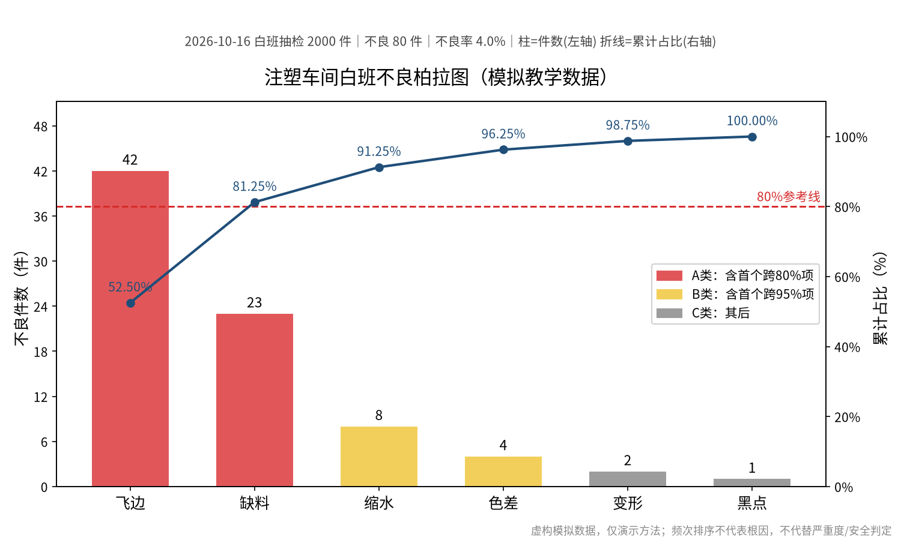

# 注塑车间一班80件不良 明早开会先查哪两类

质量统计表里有六类缺陷，明早会上要说清楚先从哪里查起。只说“全部改善”没有说明调查顺序；只挑件数最多的一项，也可能遗漏另一项主要问题。

这次用一组**模拟教学数据**，实际调用扣子上的「柏拉图质量分析器」，把数字变成可以核对的排序图和结果表。下面不是客户现场，也不是改善业绩。

## 先把同一班次的数据说清楚

教学设定是2026年10月16日白班，抽检2000件，合格1920件、不良80件；每件不良只记一个主要缺陷。不能把同一件重复计入多类后，仍把缺陷次数说成不良件数。

| 缺陷类型 | 不良件数 |
| --- | ---: |
| 飞边 | 42 |
| 缺料 | 23 |
| 缩水 | 8 |
| 色差 | 4 |
| 变形 | 2 |
| 黑点 | 1 |
| 合计 | 80 |

[下载原始输入 CSV](./input.csv) · [下载本次调用的计算结果 CSV](./result.csv)

## 调用后真正拿到了什么

在原扣子对话中选中「柏拉图质量分析器」，提供上述分类、件数、统计周期和样本口径。本次实际生成了中文PNG/SVG图和CSV结果。这里公开的是同次输出中的PNG及两份CSV，不是把宣传海报当分析结果，也不包含收费技能源码。

图中柱子是各类不良件数，按数量从高到低排列；折线是累计占比，红色虚线是80%参考线。结果CSV保留排名、单项占比、累计占比和ABC分类，读者可以拿原数据复算。

原图的图例经过一次修正：A类包含第一个跨过80%的类别，B类包含第一个跨过95%的类别。因此缺料累计81.25%仍归A类，色差累计96.25%归B类，图例与颜色按这一口径对应。它是本例约定，不是所有企业必须使用的分类标准。

## 65件与81.25%怎样帮助开会

飞边42件，加上缺料23件，合计65件：

`65 ÷ 80 × 100% = 81.25%`

在没有安全或严重度更高事项需要先处理的前提下，可以把这两类列为数量维度的优先核查对象。下一步仍需结合产品、设备、现场记录和专业判断确定调查内容，不能只凭柱状图宣布找到了根因。

另外两条容易混淆的结论也要分开：

- 本例不良率是`80 ÷ 2000 = 4%`；81.25%是两类问题占全部不良件数的比例，**不是已经降低了81.25%的不良，也不是未来保证的改善幅度**。
- 黑点只有1件，不意味着可以忽略。如果涉及安全或客户关键要求，应单独处理，不能因为排在图表末尾就降低优先级。

## 什么情况下值得考虑这款技能

对需要反复整理质量问题、又希望把分类记录转换成图表和可核对表格的人，值得考虑的是这条具体流程：提供口径一致的数据，得到排序图和累计占比，再人工核对并用于讨论。

这次可见结果证明了这一组输入能够形成图和表，不代表任意格式、任意数据都能一次成功，也没有测得普遍的节省工时比例。准备使用自己的记录时，先明确统计周期、单位、类别定义，以及同一件是否可能重复计数；缺项不要靠模型补猜。

如果你熟悉Excel，且偶尔才做一次柏拉图，自己用表格软件也可以完成，不必为了这个教学例子购买。需要的是现场根因确认、专业安全判断或自动接入企业系统的人，也不应把这个排序工具当成完整解决方案。

## 用自己的数据前先看准确商品

[查看柏拉图质量分析器的当前说明和购买选项](https://www.coze.cn/skills?skill_share_pid=7688461375559041075)

这是本例实际选择的商品，作者为`@leanedge`。价格、使用期限、运行条件和权益以你打开时的平台页面为准。请先确认与你的任务匹配，不要把其他同名工具、其他SKU或本页教学文件当成所购内容。客户名称、订单、人员及敏感质量记录应先脱敏，不贴到公开评论或Issue里。

内容说明：本文由AI辅助起草并经独立核对与编辑；图表为该技能对模拟教学数据的一次真实工具输出，数字已独立复核。图源为本次运行结果，非客户改善实绩。2026年10月17日整理。
