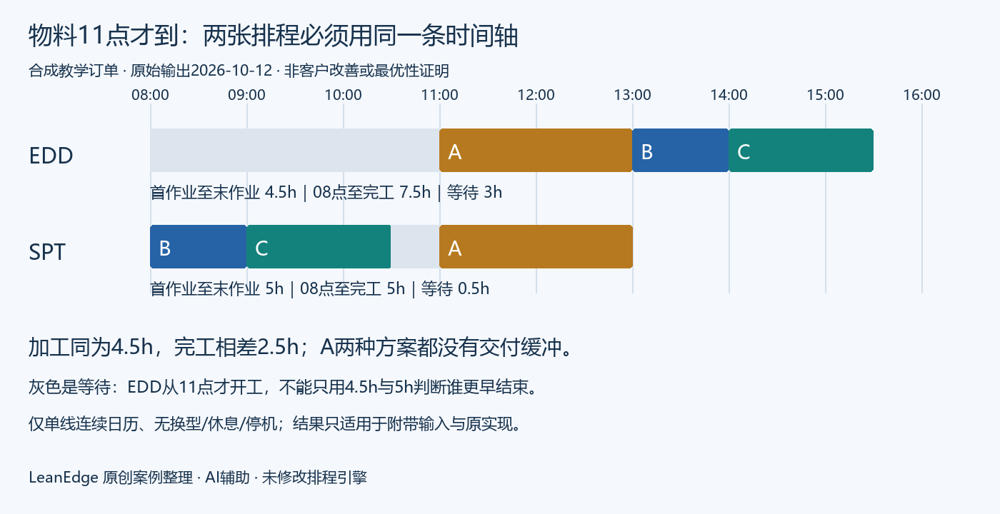

# 物料晚到时如何比较排程与等待

给单线机加工、包装及小厂的计划员：最早交付的A单要到11点才齐料，08点已经就绪的B、C要不要先做？这份实际工具输出展示了一个容易被指标藏住的等待窗口，并提供完整输入、两张计划和独立复核脚本。

这是2026年10月12日自有合成订单的本机结果，2026年10月14日整理公开；不是客户订单、现场节省或扣子在线调用。它与“三单齐料时短单优先导致急单迟交”的旧例不同：本例三单都按时，但不同计时起点会误导方案比较。

## 同一条时间轴上的两份结果



| 订单 | 数量 | 小时每件 | 加工时长 | 齐料时刻 | 交期 |
|---|---:|---:|---:|---|---|
| 急单A | 100 | 0.02 | 2小时 | 11:00 | 13:00 |
| 普通单B | 100 | 0.01 | 1小时 | 08:00 | 17:00 |
| 普通单C | 100 | 0.015 | 1.5小时 | 08:00 | 18:00 |

三单都在08:00释放；只建模一条连续日历产线，换型时间明确为0，没有休息、故障、分批和多工序。日期在附带JSON中固定为2026-10-12，所有时刻使用同一本地时间口径。

| 比较项 | 原工具EDD结果 | 原工具SPT结果 |
|---|---|---|
| 顺序 | A→B→C | B→C→A |
| A | 11:00–13:00 | 11:00–13:00 |
| B | 13:00–14:00 | 08:00–09:00 |
| C | 14:00–15:30 | 09:00–10:30 |
| 第一作业到最后作业 | 4.5小时 | 5小时 |
| 统一08点到最后完工 | 7.5小时 | 5小时 |
| 总加工时间 | 4.5小时 | 4.5小时 |
| 08点至完工内的等待 | 3小时 | 0.5小时 |
| A的交付缓冲 | 0 | 0 |

EDD在这版实现中先按交期排序再依次安排，所以为等待A而空置08:00–11:00。SPT先安排已经就绪的短单，再在10:30等半小时接A。本例SPT整批早2.5小时结束，不代表SPT在其他约束下总是更好，也不证明本例为全局最优。

## 先核时钟再比较指标

原报告的 `makespan_hours` 是首作业到末作业的跨度，不包含第一项作业之前的等待。因此4.5小于5，并不表示EDD更早完工。比较这次08点开始的任务，还必须看统一起点到末作业的7.5与5。

原结果还把EDD的 `avg_flow_time_hours` 写成3.2。若按三单都在08点释放来计算，每单流动时间应为完成时刻减释放时刻：`(5+6+7.5)/3=6.1667`小时。SPT是 `(1+2.5+5)/3=2.8333`小时。原报告的3.2与从11点第一作业开始计的平均数一致，不能拿它代替基于订单释放时点的平均流动时间。这里保留原JSON不改数，用独立复核说明口径差异。

两种方案都在13点完成A，缓冲为0。物料交到现场不一定已经完成检验、备料和首件确认；这些未建模条件可能让方案不可执行。不要把黄色风险提示当成已经安排了保障措施。

## 免费资料怎样核对

- [完整合成输入](./orders.json)
- [原EDD输出](./schedule-edd.json)
- [原SPT输出](./schedule-spt.json)
- [独立复核脚本](./audit.py)

把四个文件放在同一目录，用Python 3.9或更新版本运行 `python audit.py`。它核对固定算例的数量、工时、物料下限、单线不重叠、交期、零缓冲和两套计时口径；不是排程引擎，也不适用于直接替换为任意订单。公开包不包含收费核心。

如果不运行脚本，按上面两个表手算即可。第一步核齐料约束；第二步在同一时间轴写每单开始和结束；第三步分别算加工、等待、统一窗口和迟交；最后再看报告的数字是否使用同一口径。

## 用自己的订单前先补真实限制

计划员先向仓库核A的“11点”究竟是预计到货、到库验收还是已送到工位。班组长再核B、C能否在10:30退出设备，以及A有没有换型、检验、刀具或首件时间。无法确认就保留缺项，不填一个乐观的0。

若已取得Production Scheduling Pro下载包，可在原包目录用已有脚本重现：

```bash
python scripts/scheduler.py --orders orders.json --algorithm edd --start-time 2026-10-12T08:00:00 --output edd.json
python scripts/scheduler.py --orders orders.json --algorithm spt --start-time 2026-10-12T08:00:00 --output spt.json
```

这是本例原运行路径的说明，不是GitHub免费包提供了这些核心脚本。小时每件不能混成分钟每件；交期、释放、齐料时间写完整日期和时刻。换数据前先另存原输入，保留每次输出，别覆盖唯一结果后无法解释顺序为什么变了。

当前示例只证明本机单线连续日历的这两份结果，不证明班次、假日、跨机路由、复杂换型或所有算法都可用。原报告以24小时为参考计算的利用率也不是现场8小时班次稼动率。

## 对应工具与运行条件

需要对自己的脱敏订单生成排序、风险和甘特图，可[查看Production Scheduling Pro原商品](https://capafy.ai/zh/agent/production-scheduling-pro/2804152601)，先核运行依赖、交付范围和现价。商品页2026-10-14可读，描述为下载工具、Python 3.8及以上、核心无需API密钥；本公开复核脚本按Python 3.9及以上使用。宿主软件、运行权限和费用另按实际条件确认，不承诺额外实施或无限支持。

首次使用先保留这份小样并核对两张表，再换自己的数据。需要反馈时，只描述脱敏字段、规则、报错和期望结果，不公开客户货单、真实价格、合同、个人信息或密钥。本例资料与文字为自有原创整理，含AI辅助；可内部复制使用并保留来源，不获得第三方软件或付费核心的转售权。
