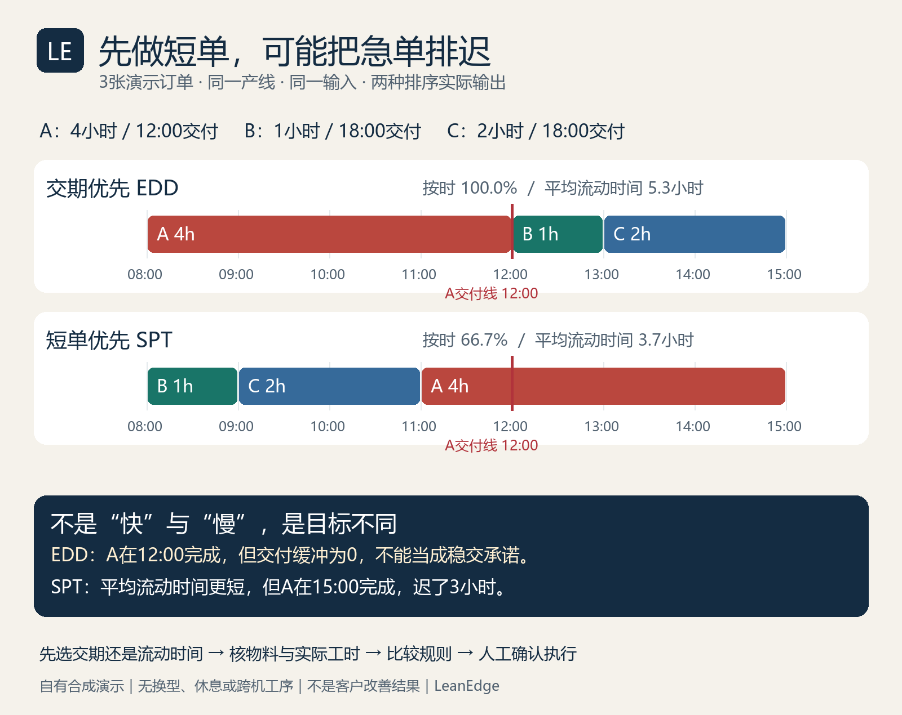

# 排产不是“先做短单”：3张订单跑出两种结果

**给生产计划员、班组长和小厂负责人：同样7小时的工作，先后顺序一变，平均流动时间变短了，急单却迟交3小时。**

这里公开的是 Production Scheduling Pro 在本机实际运行的输入、两份原始结果、甘特图和独立复算代码。所有订单都是自有合成演示，不是客户订单，也没有对应的营收或现场改善数据。实跑日期：2026-10-12。



## 一、现场会卡在哪里

早上8点，三张订单都准备好了。有人说先把小单清掉，让产线“快一点”；有人说中午要交的单必须先做。问题不在谁更勤快，而在这轮排产到底保什么：交付时间，还是订单平均流动时间。

先把输入放在台面上，而不是让模型凭感觉排：

| 订单 | 数量 | 单件工时（小时/件） | 总加工时间 | 交付时间 |
|---|---:|---:|---:|---|
| A，交期紧单 | 1000 | 0.004 | 4小时 | 当天12:00 |
| B，短单 | 500 | 0.002 | 1小时 | 当天18:00 |
| C，普通单 | 1000 | 0.002 | 2小时 | 当天18:00 |

本例只用一条连续日历产线。三单都在08:00释放且物料到齐；换型时间显式设为0；没有休息、停机、跨机工序和分批。加工时间＝数量×单件工时，合计7小时。输入文件为 [demo-input.json](./demo-input.json)，不是为了显示“好结果”而隐去现实约束。

## 二、同一输入，实际跑两次

| 指标 | 交期优先 EDD | 短单优先 SPT |
|---|---|---|
| 实际顺序 | A → B → C | B → C → A |
| A完成 | 12:00 | 15:00 |
| B完成 | 13:00 | 09:00 |
| C完成 | 15:00 | 11:00 |
| 整批完工 | 15:00 | 15:00 |
| 本例按时订单 | 3/3，100% | 2/3，66.7% |
| 最大迟交 | 0小时 | 3小时 |
| 平均流动时间 | 5.3小时 | 3.7小时 |

原始结果：[EDD JSON](./schedule-edd.json) · [SPT JSON](./schedule-spt.json)。两份可下载甘特图：[EDD HTML](./gantt-edd.html) · [SPT HTML](./gantt-spt.html)。GitHub直接打开HTML通常只看源码；请下载后在本机浏览器打开。

这不是一个算法全面胜出。SPT让B和C更早完成，平均流动时间降低；代价是A晚了3小时。EDD保护了这次交期，但A恰好12:00完成，**缓冲为0**。哪怕发生一点异常，也可能迟交；“本例100%按时”不能变成实际交付承诺。

## 三、不靠软件自己夸自己，拿纸也能复算

所有订单都在08:00释放，所以本例流动时间＝完成时间－08:00：

- EDD：A为4小时，B为5小时，C为7小时；平均值 `(4+5+7)/3 = 5.333…`，输出显示5.3。
- SPT：B为1小时，C为3小时，A为7小时；平均值 `(1+3+7)/3 = 3.666…`，输出显示3.7。
- 迟交时间＝`max(0, 完成时间－交付时间)`。SPT下A在15:00完成，交期12:00，迟交3小时。
- 两种规则都没有减少总加工时长；7小时没有凭空变成5小时。

我们额外用 [audit.py](./audit.py) 独立复算每单起止、数量与工时、物料就绪、单线不重叠、指标和A的零缓冲。下载本目录中的JSON与该脚本，Python 3.9+运行：

```bash
python audit.py
```

这是免费公开的结果复核脚本，不是付费排产引擎。它只检查这个三单演示；更换输入时需要同步检查断言，不能当通用验收器直接套用。

## 四、购买工具后怎样用自己的订单复现

在已取得的 Production Scheduling Pro 商品包目录，使用原有脚本，不需要模型API密钥：

```bash
python scripts/scheduler.py --orders demo-input.json --algorithm edd --start-time 2026-10-12T08:00:00 --output schedule-edd.json
python scripts/scheduler.py --orders demo-input.json --algorithm spt --start-time 2026-10-12T08:00:00 --output schedule-spt.json
python scripts/gantt.py --schedule schedule-edd.json --output gantt-edd.html
python scripts/gantt.py --schedule schedule-spt.json --output gantt-spt.html
```

先把公开输入复制到商品包目录，或把 `--orders` 改成实际文件路径。以上是已在本机运行的命令；购买平台托管环境是否提供同样文件路径与Python运行权限，需要按商品实际运行条件确认。付费核心脚本没有放进本公开目录。

如果用AI宿主调用，可以这样说：

> 用Production Scheduling Pro处理这3张订单。从2026-10-12T08:00:00开始，分别跑EDD和SPT。先检查物料和释放时间，再给每单起止、迟交、平均流动时间和两份甘特图。A必须中午交付，说明每种规则的代价和零缓冲风险，不承诺最优或自动执行。

这段是可复制的调用建议，不是扣子在线调用录像。实际证据是本页原始JSON与本机产出的甘特HTML。

## 五、拿到报告，不要直接下发到车间

1. **核单位**：`cycle_time_per_unit` 是小时/件，不是分钟/件。每件14.4秒应填0.004小时，不能填14.4。
2. **核日期**：这版引擎中，只有日期的交期表示当天00:00。要当天18:00，请写完整 `2026-10-12T18:00:00`；输入统一使用不带时区的本地ISO时间。
3. **核就绪**：填写订单释放时间和物料ETA。现实中没到料、没首件确认，不能因为图表排进去了就开工。
4. **核可执行时间**：当前下载版是单线、连续日历引擎，不执行班次、假期、跨机路由、保质期和复杂换型矩阵。实际工厂必须另核这些限制。
5. **核缓冲与责任人**：A零缓冲，应由计划员与班组长确认风险动作。软件提示“加急/加班”不是已经安排加班，也不能替代安全与用工判断。

原输出还有一个以24小时作参考窗的简化利用率29.2%。这里不把它宣传成实际班次稼动率，更不据此宣称增加产能或节省工资。EDD/SPT是排序规则，本例也不证明它们能解决所有约束或保证全局最优。

## 六、下一步只选一个入口

需要用自己的订单跑排序、看风险和甘特图：[查看已上架的 Production Scheduling Pro](https://capafy.ai/zh/agent/production-scheduling-pro/2804152601)。运行要求、交付内容和现价以商品页为准，不承诺额外实施或无限支持。

只想先判断是不是你要的结果？先下载本例的两份JSON和甘特图，按第三节复算。如果有具体问题，可在本仓库提出**脱敏的字段与规则问题**；不要上传客户订单、联系方式、合同、真实产能机密或账号密钥。

本页是同一原创主件的公开案例，不是新上架技能。排产工具与Coze工厂布局/2D转3D商品独立，不共用订阅或自动串联。内容含人工智能辅助制作；数据和结论以附带输入与可复算输出为准。
