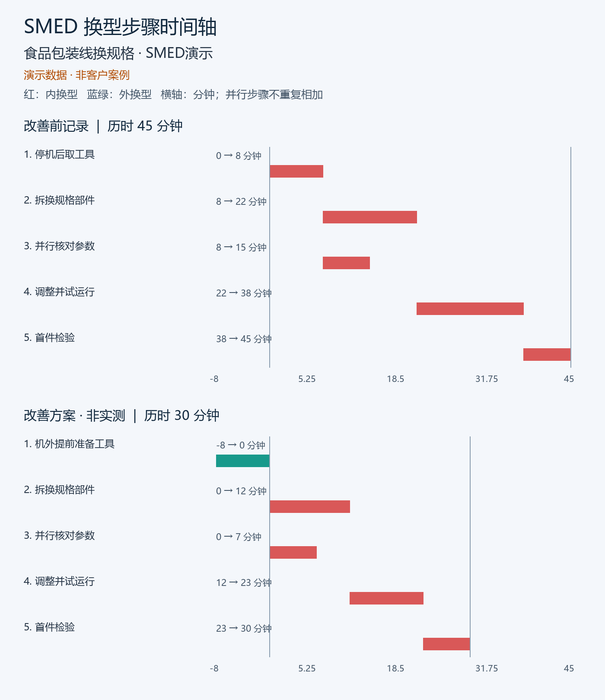
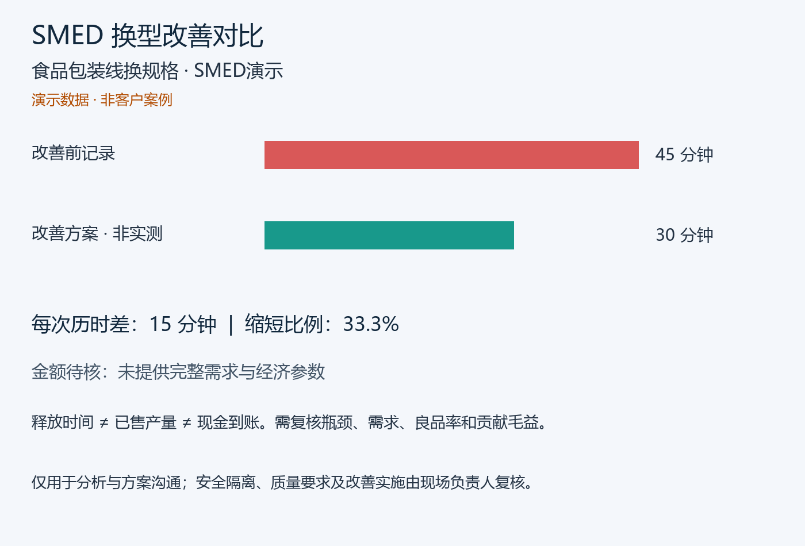

# SMED换线记录为什么相加52分钟却只停机45分钟

一张换线表里，5个动作的时长加起来是52分钟，设备停机却只有45分钟。算错了吗？在下面这份人工设计的演示中，答案是：有一段核对动作与拆换部件同时发生，不能把它再加到停机历时上。

这份演示用 **SMED Visual Changeover Report Kit** 本机生成。你可以先看实际输出，再判断是否适合自己的换型复盘。全部业务数据是示例；30分钟是改善提案，不是客户已实现的结果。

## 完整讲解V3：先看清口径，再知道怎样调用

[观看或下载新版讲解MP4](./smed-52-vs-45-v3.mp4) · [新版同步字幕SRT](./smed-52-vs-45-v3.srt)

新版约113.5秒，按一个完整任务讲清：计时冲突与产品→并行7分钟→记录字段→本地解压与运行命令→真实图表与文件→怎样再做一次同口径实测→免费样例与准确购买入口。它明确这是本地下载工具，展示输入JSON、输出目录与报告的对应关系，不冒充本轮Coze调用或软件操作录像。时间轴局部放大展示，原图可在下方完整查看。

旁白为合成音，不是本人录音；演示数据与未验证提案标识保留。原68.6秒版保留历史文件、不再推荐；V3是同一案例的叙事修订，不是新增客户成果。

## 两张实际报告图

### 步骤时间轴



图中每条横条对应一个动作的起止时刻。红色是本次输入标为内换型的动作，蓝绿色是标为外换型的动作；工具展示这些分类，不替现场判定安全性。

### 前后对比



图里的15分钟差额、33.3%比例是这组演示输入的计算结果。30分钟方案还需要现场试验；没有需求、产能和成本资料，报告不会编出节省金额。

[下载可独立打开的HTML报告](./report.html) · [查看输入JSON](./demo-input.json) · [查看计算摘要](./summary.json)

下载report.html后可用浏览器离线打开，两张图已嵌入文件，无需另找图片。GitHub本身可能把HTML显示为代码，请下载后查看。

## 把52分钟和45分钟拆开看

| 示例动作 | 开始 | 结束 | 动作时长 |
|---|---:|---:|---:|
| 停机后取工具 | 0 | 8 | 8分钟 |
| 拆换规格部件 | 8 | 22 | 14分钟 |
| 并行核对参数 | 8 | 15 | 7分钟 |
| 调整并试运行 | 22 | 38 | 16分钟 |
| 首件检验 | 38 | 45 | 7分钟 |

动作时长相加为8+14+7+16+7=52分钟。示例的停机窗口则是从0到45分钟。8到15分钟的核对动作与拆换部件重叠，不能再顺序加一次。

这两个口径回答不同的问题：动作时长合计帮助检查工作量，停机历时帮助理解设备被占用多久。未记录人数、资源与依赖时，也别把动作总和直接当成人工工时或可并行的证明。

## 先收这些记录再让AI整理

| 字段 | 填什么 | 容易踩的坑 |
|---|---|---|
| 换型开始和结束口径 | 本次以哪个事件起表、哪个事件停表 | 前后两次测量口径不一致 |
| elapsed_minutes | 实际经过的历时 | 把所有步骤简单相加 |
| name | 可辨认的动作名称 | 只写准备、调整，无法追到动作 |
| start和end | 相对起点的开始、结束分钟数 | 只写持续几分钟，看不出重叠 |
| type | internal或external | 未复核安全就把动作挪到运行中 |
| after.kind | proposal或measured | 把还没试的计划标成已实测 |

没有改善后的观测，可以先不填after。准备动作若在停机前完成，可以用负时间表达，例如-8到0；这不代表任何涉及设备、清洁或质量的动作都适合提前做。

AI可以帮助整理记录和讨论实验，但最终分类、依赖与实施要由现场负责人确认。不要为了让图更好看，把安全隔离、清洁验证或首件检查删掉。

## 下载工具后怎样复现

工具是本地下载包，不是在线网页服务。需要Python 3.9以上、Pillow和可用的中文字体；图表及报告为中文。字体文件和第三方程序不包含在下载包中。

1. 从下方Capafy商品页下载并解压工具，找到scripts/render_report.py。
2. 把本页demo-input.json放到工具根目录。先按示例运行，确认字体和输出正常，再换自己的记录。
3. 在该目录执行：

```powershell
python scripts/render_report.py demo-input.json --output outputs/first-report
```

4. 打开timeline.png、comparison.png和report.html，核对每个动作、停机历时、演示或实测标识，并查看summary.json中的计算。

原输出目录受到覆盖保护，下次换一个目录名。工具脚本本身在本机运行，不调用模型API、不上传记录；你使用的智能体宿主若收费，费用另计。

## 下一次只验证一个具体改法

本演示提出提前备工具的方案。实际使用时，先选出对应动作，写清谁来做、提前条件是什么、会不会影响安全或质量，再测同口径的下一次换型。

把“我们应该更快”改成“下一次验证这一步”：记录实际起止、返工、质量检查和新增负担，再决定保留还是撤回。现场还没测过，就继续标成提案。

## 获取工具和反馈

- [SMED Visual Changeover Report Kit商品页](https://capafy.ai/zh/agent/smed-visual-changeover-report-kit/9311408133)：查看下载内容、依赖、现价和购买方式。
- 已有订单，需要讨论生产顺序：[Production Scheduling Pro商品页](https://capafy.ai/zh/agent/production-scheduling-pro/2804152601)。这是独立工具，不是本报告自动串联的下一步。
- 技术问题可按[仓库首页的联系入口](../../README.md#联系与反馈)反馈。描述系统、命令和报错，先删去客户、员工和订单隐私，不必公开真实生产资料。

这份教程公开演示输入与结果，不包含付费工具的完整渲染器。两款商品的公开页面与上架状态于2026-10-12核对。
