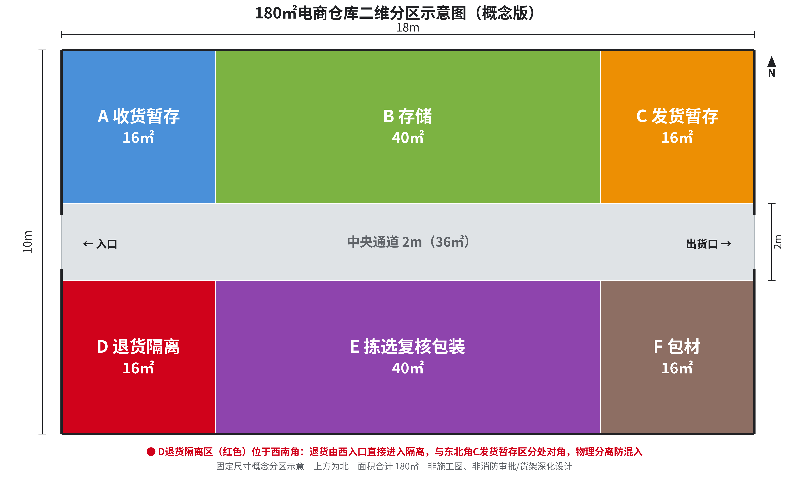

# 180平方米仓库退货隔离案例

退回来的箱子还没检查，就和待发货混在一起？先把“放在哪里”和“谁能放行”说清楚，比画一张漂亮的仓库图更重要。

这里展示一次 **LeanEdge 自有虚拟仓库演示**：调用工厂智能布局设计助手，把预先指定的18m×10m场地、6个功能区和中央通道，整理成可讨论的二维分区图。不是客户现场，也不是自主优化或施工图。

## 先看实际结果

[观看83.3秒完整讲解视频](./warehouse-180-explained-v2.mp4) · [下载原始PNG](./output.png) · [查看原始SVG](./layout-original.svg)

视频按“混放问题→卡点→调用与输入→实际结果→现场交接→预览入口”讲解，含同步配音、字幕和分区标注。末尾提到的技能与预览入口，均可在本页结尾找到。配音为合成音，不是本人录音。

## 业务输入

西南角为原点，向东是x、向北是y；全部尺寸单位为米。中央通道贯穿东西，两排功能区分别在通道两侧。

| 区域 | 坐标范围 | 面积 | 本次指定用途 |
|---|---|---:|---|
| A | x0–4，y6–10 | 16㎡ | 收货暂存 |
| B | x4–14，y6–10 | 40㎡ | 存储 |
| C | x14–18，y6–10 | 16㎡ | 发货暂存 |
| D | x0–4，y0–4 | 16㎡ | 退货隔离 |
| E | x4–14，y0–4 | 40㎡ | 拣选、复核、包装 |
| F | x14–18，y0–4 | 16㎡ | 包材 |
| 中央通道 | x0–18，y4–6 | 36㎡ | 西端进入、东端出货 |

功能区合计144㎡，通道36㎡，合计180㎡。这些位置是本次输入指定的，不是模型算出的最优方案。

[复制本例业务输入](./input.txt)。换成自己的场地时，别直接照搬坐标：先补齐尺寸、门位、柱网和不能移动的设施。

## 在扣子里怎样调用

1. 打开扣子对话，在输入框下方“+”选择 **工厂智能布局设计助手**，或通过下方商品入口进入。
2. 说明场地长宽、出入口、固定设施、设备或货物、作业顺序，以及必须隔开的区域。
3. 本次输入明确要求二维PNG和同图SVG，不让程序生成第二套方案；截图与输出用于前期讨论。
4. 收到结果后，核对尺寸、区域名称、门位和面积。不能只看配色，更不能把概念图直接拿去施工。

本例的实际运行过程是创建SVG、转成PNG并验算面积，原始PNG为4100×2520，SVG保留文字和图形。没有使用三维生成或物流仿真。

## 图画清了，还要补上状态交接

D区在西南角，C区在东北角，可以让退货和待发货在位置上分开；现场能否避免混入，还取决于标识、人员和放行记录。

| 交接动作 | 建议负责人 | 留下的记录 |
|---|---|---|
| 收到退货先进入隔离区 | 收货人 | 退货编号、数量、时间、待检状态 |
| 检查后判定处理方式 | 指定检查人 | 检查结论、日期、对应编号 |
| 确认能否恢复可用库存 | 业务规定的放行人 | 放行或不放行记录 |
| 核对实物与系统状态 | 接班人 | 交接数量、位置、未结事项 |

上表是配合这张图的管理建议，请按实际业务制度安排。通道宽度、消防、叉车、货架和工程要求，需要专业人员结合现场复核。

## 用自己的图先看一张预览

**发平面图给我，免费出一张效果预览。** 请使用你有权提供的图纸，先去掉客户姓名、地址等隐私，并准备长宽、门位、用途和必须隔开的区域。

- 自己使用：[工厂智能布局设计助手](https://www.coze.cn/skills?skill_share_pid=7597450318019903551)。
- 申请一次免费单图预览或咨询人工服务：[闲鱼服务入口](https://www.goofish.com/item?id=1080049343062)。
- 已有平面图、需要空间概念表达：[2D平面转3D效果图](https://www.coze.cn/skills?skill_share_pid=7640904637083664434)，这是另一款独立商品，不是本例二维图的自动后续步骤。
- [官网布局与案例入口](https://www.angetlean.com/layout/)。

一次免费预览不包含完整布局服务或施工图；购买价格、订阅权益及人工服务范围按对应平台说明确认。请勿把私人图纸发到公开Issue或评论。

本例固定尺寸、区域和用途均为演示设定，原输出未经改画；文件摘要见[文件校验清单](./checksums.txt)。内容含人工智能生成合成内容。
